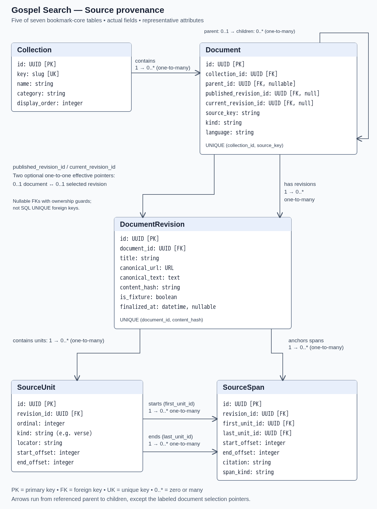
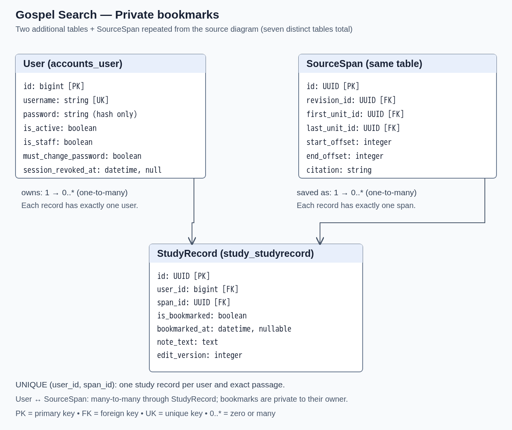

# Module 5: Data Model and Backend

## App Summary

Gospel Search is an independent student project for people studying scripture and related gospel resources. These readers often need to move between several websites to find passages and keep track of what they discover. The app brings searchable scripture, General Conference, BYU devotionals, Come, Follow Me, Bible Dictionary, and Topical Guide material into one study experience. Search results show passages grounded in stored source text, with citations and original-source links, rather than chatbot-authored quotations. A focused scripture reader lets users open available chapters and select a verse or adjacent verse range. Signed-in users can bookmark passages and return to them in their private study list. Those bookmarks are saved in PostgreSQL, so refreshing the page does not reset them. The application is a private-network study tool, not an official Church or BYU product.

## ERD

This assignment shows the **seven-table bookmark and source-provenance subset** of the implemented database, not the complete application schema. The diagrams are PNG images; no Mermaid renderer is required. Attributes use actual model/column names and show representative fields, not every application field.





`SourceSpan` appears in both images to connect them; it is **one table**, not a duplicate. `PK` means primary key, `FK` means foreign key, and `UK` means unique key. UUID identifies most entities; Django's user table uses a bigint ID. Physical tables are `sources_collection`, `sources_document`, `sources_documentrevision`, `sources_sourceunit`, `sources_sourcespan`, `accounts_user`, and `study_studyrecord`.

| Relationship | Cardinality and meaning |
| --- | --- |
| Collection → Document | One-to-many: each document belongs to one collection; a collection may have zero or many documents. |
| Document → Document (parent) | One-to-many: a document may have zero or many children; a child has zero or one parent. |
| Document → DocumentRevision | One-to-many: each captured revision belongs to one document; a document may have zero or many revisions. |
| Document → published/current DocumentRevision | Optional one-to-one **effective pointer** relationships: each document selects zero or one revision for each pointer, and a selected revision can be named only by its own document. These are nullable foreign keys plus database ownership guards, not SQL `UNIQUE`/Django `OneToOneField` columns. |
| DocumentRevision → SourceUnit | One-to-many: a revision contains zero or many ordered source units; each unit belongs to one revision. |
| DocumentRevision → SourceSpan | One-to-many: a revision anchors zero or many spans; each span belongs to one revision. |
| SourceUnit → SourceSpan (first/last) | Two one-to-many relationships: every span has exactly one first unit and one last unit; a unit may start/end zero or many spans. |
| User → StudyRecord | One-to-many: a user owns zero or many study records; each record has exactly one owner. |
| SourceSpan → StudyRecord | One-to-many: a span may have zero or many study records; each record refers to exactly one span. |

Users and source spans consequently have a many-to-many association **through StudyRecord**. The unique `(user_id, span_id)` constraint allows only one study record per user and exact passage. The record stores bookmark state and may also hold a note; removing a bookmark does not remove an existing note. Stored spans refer to immutable revisions, so later source updates do not silently change a saved passage. A span's first and last units must belong to that same revision. Only publication-proven source revisions are available to anonymous readers; supporting publication, processing, search, and authentication tables are outside this focused diagram.

### Sample rows for the assignment

The application creates its tables with existing Django migrations. A clone does **not** contain the acquired corpus or personal study rows. Prepare data using the existing application; do not insert invented scripture or bypass validation with direct SQL writes.

1. Follow the setup below to publish a bounded sample of real scripture chapters. Collection configuration is initialized automatically; acquisition creates documents, revisions, verse units, and validated spans.
2. Using the administrator's **Accounts** panel, create at least two ordinary class demonstration accounts. Deliver their temporary passwords privately; each user signs in and changes the password before using study functions.
3. Using those accounts, bookmark several different verse selections. Prepare at least three StudyRecord rows in total; the administrator plus two ordinary accounts provide at least three User rows. These are deliberately prepared demonstration records, not simulated persistence.
4. Run this **read-only** check from the private application checkout. It returns only table counts, not usernames, passwords, notes, or scripture text:

```sh
docker compose exec -T backend python manage.py shell -c 'from django.contrib.auth import get_user_model; from sources.models import Collection, Document, DocumentRevision, SourceUnit, SourceSpan; from study.models import StudyRecord; models = [Collection, Document, DocumentRevision, SourceUnit, SourceSpan, get_user_model(), StudyRecord]; counts = {m._meta.db_table: m.objects.count() for m in models}; print(counts); assert all(n >= 3 for n in counts.values()), "Prepare at least three rows in every pictured table before submission"'
```

Expected: all seven table names appear with counts of at least three and no assertion error. Counts alone do not prove publication or successful bookmarking; also perform the UI checks below. **No fresh database counts or live validation results are claimed by this document.** If preparation is incomplete, complete it before submission rather than reporting it as passed.

## Tech Stack

| Layer | Technology | Why it fits our team |
| --- | --- | --- |
| Frontend | React, TypeScript, Vite, HTML/CSS | Supports the interactive search, scripture reader, and bookmark UI with typed frontend code. |
| Backend/API | Python, Django, Django REST Framework | Provides migrations, session authentication, administration, ownership checks, and JSON endpoints. |
| Database | PostgreSQL with pgvector | Keeps source relationships, immutable passages, and private study records in one persistent relational database; also supports the larger app's search indexes and embeddings. |
| Background processing | Database-backed Django worker | Acquires and processes sources outside browser requests, with durable jobs and recovery. |
| Model services | Configurable external embedding/instruction endpoints | Supports the larger search pipeline; source publication requires compatible embeddings. Bookmark saves themselves do not call a model. |
| Deployment | Docker Engine, Compose v2, GNU Make, Caddy HTTPS | Gives teammates one coordinated stack and persistent database volumes, instead of independently assembled setups that drift. |

This is a team-built application, not a backend-as-a-service or hosted AI builder. It gives us direct access to our code, tables, migrations, and permission logic, at the cost of more initial setup and operating responsibility. We use privately operated infrastructure and model services rather than depend on a cloud free tier; compute, storage, and upkeep still have costs. Only the private HTTPS application port is exposed; PostgreSQL and workers remain internal. The bookmark slice uses an authenticated Django session and CSRF-protected requests, not browser-local bookmark storage.

## How to Get It Running

### Access and prerequisites

**This public repository contains the assignment README and ERD images only. It is not the application source and cannot run the app.** Obtain authorized access to the private application repository and the team's private model configuration before following these steps. Ask the team for access if you are reviewing the assignment; the public documentation link does not grant source or private-network access. No credentials or private repository/model addresses are published here.

Use a host with Git, GNU Make, Docker Engine, Docker Compose v2, OpenSSL, and access to the intended embedding service and official scripture sources. Python and Node tooling run in containers. Perform this setup in a **fresh, separate private application checkout**, not against an existing production installation. Do not create a second competing team deployment; nominate one administrator and have teammates use the same prepared app.

### 1. Clone the authorized application and build

Replace the repository URL placeholder with the private URL supplied by the team:

```sh
git clone <PRIVATE_APPLICATION_REPOSITORY_URL> gospel-search-class
cd gospel-search-class
make install
```

`make install` builds images and creates a private `.env` with generated database/Django secrets only if that file does not already exist. It does not start source acquisition. Do not clone this documentation-only repository expecting these commands to exist.

### 2. Configure the real-source stack before first start

Edit the generated `.env` privately; retain its generated secrets. For a browser on the same host, keep its default local identity (`HTTPS_BIND=127.0.0.1`, port `8443`, and localhost/127.0.0.1 certificate configuration). A team-network installation must instead use the coordinated private host identity and certificate settings provided by the administrator.

- Set `DEMO_MODE=false` and `INFERENCE_BACKEND=openai`; do not use demo embeddings with real-source publication.
- Enter the team-provided `INFERENCE_EMBEDDINGS_BASE_URL`, `INFERENCE_EMBEDDINGS_MODEL`, and API key if required. The base URL excludes `/v1`; it must be reachable **from the container**, so container `127.0.0.1` does not identify an external host service.
- Set the team's compatible profile recipe: stored/native dimensions, reduction, query/document prefixes, tokenizer/token-count configuration, normalization behavior, and passage recipe. Do not guess these values or change `.env` alone to replace a profile on an existing database. The private checkout's `docs/deployment.md` and `docs/embedding-operations.md` contain the supported settings and activation procedure; the team must supply the applicable private service values.
- Set `INFERENCE_TEXT_BACKEND=off` for this minimal bookmark walkthrough; optional generated summaries and text-model search features are not needed. Do not silently substitute another model service.
- Set `FIRST_ADMIN_USERNAME` to the chosen administrator username and `FIRST_ADMIN_PASSWORD` to a strong **private** first-start password. Do not copy the password into this README, screenshots, Git, or the video.
- Keep the existing approved scripture hosts and bounded-download settings. Ensure disk headroom for the database, indexes, and pinned scripture dataset cache; a small chapter sample can still require downloading a larger candidate dataset file.

The private application already ignores `.env`. Protect it with `chmod 600 .env`; do not commit it or print its contents into public reports. No shared default password is provided.

### 3. Start, trust HTTPS, and sign in

```sh
make run
docker compose ps -a
docker compose logs --tail=80 init
docker compose cp caddy:/data/caddy/pki/authorities/local/root.crt ./gospel-search-root-ca.pem
```

Expected: `init` exits successfully with code 0, database/backend are healthy, and the worker is running. Initialization applies existing migrations and collection/feed configuration; it never crawls at startup. If init fails, inspect private logs and correct configuration before proceeding; do not publish those logs without screening them.

Import **only** the exported CA certificate into the test client's OS/browser trusted-root store before entering credentials. Trust-store steps differ by OS; use the private checkout's `docs/deployment.md` HTTPS section. Never export CA private keys or treat bypassing a certificate warning as trusted HTTPS. Open `https://localhost:8443/ops` for the local setup (or the team's configured private HTTPS origin) and sign in as the first administrator.

After successful sign-in, clear `FIRST_ADMIN_PASSWORD` in `.env`, retain the username, and remove the bootstrap password from inherited container environments:

```sh
docker compose stop
docker compose up -d --force-recreate
```

Volumes and the existing administrator are retained. Do not run `down -v`, prune volumes, or remove the database to troubleshoot an ordinary restart.

### 4. Activate the compatible embedding profile

In `/ops` → **Acquisition**, find **Embeddings & serving**:

1. Choose **Prepare rebuild from configured endpoint**.
2. Choose **Start staging** for that operation.
3. Wait for **Readiness checks pass — ready to activate**.
4. Choose **Activate serving profile**, then **Confirm activation**.

Require the intended model/dimensions/recipe and an open acquisition gate. On an empty database, profile activation is not proof of a successful model request; actual source publication must succeed next. Stop and diagnose unavailable endpoints or failed readiness rather than claiming the setup works.

### 5. Publish a bounded real-scripture sample

In **Acquisition**, select **Sample (bounded)**, set the item limit to **10**, and choose **Start scriptures-json** once. Alternatively, from this same private checkout:

```sh
docker compose exec backend python manage.py acquisition start --feed scriptures-json --mode sample --limit 10
docker compose exec backend python manage.py acquisition status --feed scriptures-json
```

The start action queues work; the worker acquires chapters, reconciles verse text against the official English source, validates it, indexes/embeds it, and publishes only after required stages pass. Repeat the read-only status command or watch the UI until actual chapter publications are available. Discovery counts, exclusions, or a completed run alone do not prove readable content. Inspect the inventory for a published chapter and use it in the reader; do not promise a particular chapter before it is available.

This slice needs only available ordinary chapters from `scriptures-json`. The broader project's Official Declarations/facsimile coverage uses the separate `scriptures-supplement` feed; it is not needed for this bookmark demonstration. A bounded sample is **not** a full scripture corpus. Do not select full backfill or start unrelated feeds for this assignment.

### 6. Prepare a study account

In `/ops` → **Accounts**, create an ordinary demonstration account. Deliver the generated temporary password privately. Sign out of the administrator account, sign in at `/account` with the demonstration account, and replace the temporary password when prompted. Password replacement is required before personal study actions; there is no public registration. Create the additional demonstration account/rows described in the sample-data checklist before submitting.

## Verifying the Vertical Slice

**Action:** bookmark a scripture passage and prove it persists after refresh.

1. Sign in with the prepared ordinary account. Keep passwords and administrator setup out of the recording.
2. Open `/read` and choose a chapter that the previous acquisition step actually published. Unacquired chapters are honestly shown as unavailable.
3. Select a verse or adjacent verse range using the start/end controls. Pick a selection not already bookmarked so the change is visible.
4. Click **Bookmark this passage**. Wait for the saved/bookmarked status; a failed request is not a successful demonstration.
5. Open **Bookmarks** through the study navigation (`/study/bookmarks`). Confirm the same citation and passage appear in that account's list.
6. Refresh the Bookmarks page. Wait for it to load and show that the same passage is still present. Optionally sign out and back into the same account to verify that the bookmark is account data rather than transient UI state.

### What the button does end to end

The reader sends `POST /api/study/selections/` with the displayed revision and chosen verse range (or an existing span ID). The authenticated backend validates the selection, creates/reuses its SourceSpan, and creates/reuses the owner's StudyRecord in PostgreSQL. If the record is not yet bookmarked, the frontend sends `POST /api/study/records/<record_id>/` with `is_bookmarked=true` and the expected edit version. The backend saves bookmark state atomically and returns the updated record; the frontend shows the saved state. Refreshing Bookmarks performs a new server read of the owner's stored bookmarked records. Neither operation fetches new scripture or calls a model.

Each saved selection belongs to exactly one account, and stale edits are rejected rather than silently overwriting newer data. Recording refresh persistence is the required visible proof; database row counts support preparation but do not replace that proof.

### Video and submission checklist

The team records a video **two minutes or less**, showing only: click the bookmark button → show the saved passage in Bookmarks → refresh and show it remains. Have the app, account, and published chapter ready before recording; do not include installation, passwords, private URLs, or private notes.

Submit two links: the team's accessible demo-video link and this public repository's README link. Before submission, open both in a private/incognito window and verify that the video and both ERD images are accessible without GitHub sign-in. The public README does not make the private running app public, grant private-code access, or authorize source-content redistribution.
